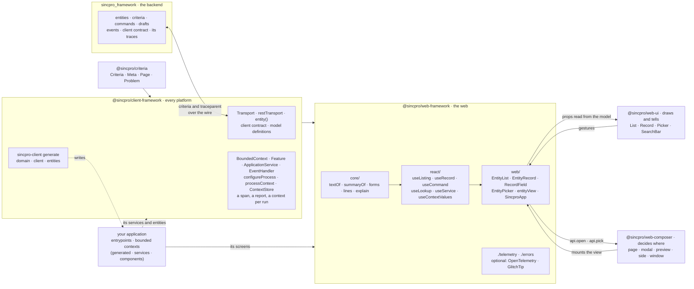
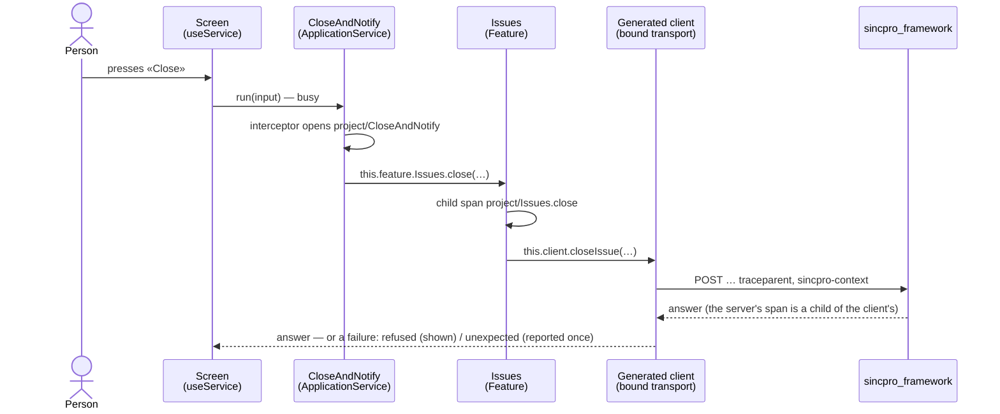
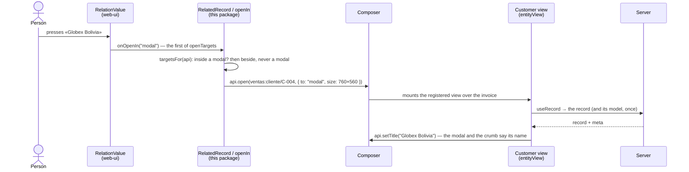
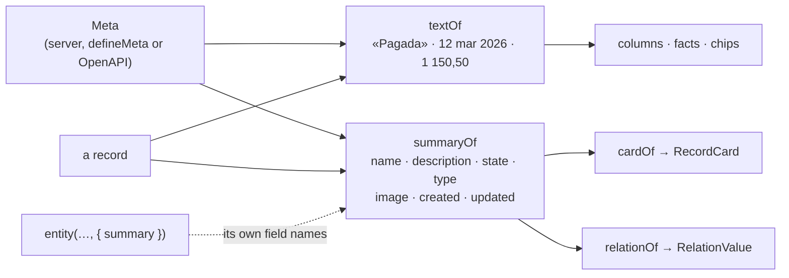

# @sincpro/web-framework

**The web side of how Sincpro builds business software.** It takes what
[`sincpro_framework`](https://github.com/Sincpro-SRL/sincpro_framework) already resolves on the
server — entities, criteria, commands, drafts, events — and puts it on screen with
[`@sincpro/web-ui`](https://github.com/Sincpro-SRL/sincpro_web_ui), opened where
[`@sincpro/web-composer`](https://github.com/Sincpro-SRL/sincpro_web_composer) says. What every
client shares — the transport, the entities, the generated client, the application's use cases
traced and reported — is
[`@sincpro/client-framework`](https://github.com/Sincpro-SRL/sincpro_client_framework)'s; this
package is the screens. An application declares its entities and names its fields; the rest
follows. Every Sincpro framework speaks one
[ubiquitous language](https://github.com/Sincpro-SRL/sincpro_client_framework/blob/main/docs/UBIQUITOUS_LANGUAGE.md):
a bounded context, a Feature, the process, the context mean the same here, on the phone and on
the server.

```bash
yarn add @sincpro/web-framework @sincpro/client-framework @sincpro/web-ui @sincpro/web-composer \
  @sincpro/criteria @sincpro/criteria-react react react-dom
```

Requires React 19 or newer.

## What we believe

> The founding statement is [`MANIFESTO.md`](MANIFESTO.md): what this repository is, what it is
> not, how it is composed and where it is going. What follows is how those beliefs show in the
> pieces that exist today.

**An ERP is modular, so its framework must be open.** Somebody will always have the case nobody
foresaw — a reconciliation screen, a strange relation, a wizard over three entities. They must
be able to build it here, without asking us and without fighting us. So:

1. **Defaults, never cages.** Every piece comes in three levels, and any of them can be skipped:

   | Level        | What you write                              | Example                                                    |
   | ------------ | ------------------------------------------- | ---------------------------------------------------------- |
   | Declarative  | names of fields and entities                | `<EntityList listing={l} columns={["number", "state"]} />` |
   | Hooks        | your own screen over our state              | `useListing` + web-ui's `List`                             |
   | Loose pieces | straight to criteria, the transport, web-ui | `transport.list(route, criteria)`                          |

   Adding a piece obliges nothing else; removing it breaks nothing else.

2. **We ship good practice, not business rules.** A rule lives in the backend. Here the
   framework reads what the backend publishes — the model definition, the form hints, the
   preview, the refusal — and never re-implements it. If a rule matters, the server keeps it.

3. **Integration should be solved once, here.** Every Sincpro application used to write its
   own client, its own date formatting, its own error box, its own "load more". That is the
   same code everywhere, and it belongs in one place, written well.

4. **The server describes, the screen decides.** The backend says what a field _is_ — its
   word, its type, what it accepts, what it points at. Where it goes, how prominent it is and
   what colour a state is stay in the screen's code. That keeps us out of server-side view
   XML, which is where frameworks like Odoo stop being extensible.

5. **Many entities, one screen.** Business work happens _between_ records: a list with its
   detail beside it, an invoice with its lines, a statement reconciled against invoices. The
   framework is built for that, not for one form at a time.

6. **Use the whole Sincpro stack, not a copy of it.** Composer already knows where things open,
   what is selected and which keys do what; web-ui already knows how a record looks. This
   package uses them — it does not wrap them in a second, weaker version.

## The stack

| Project                     | Brings                                                                                                                                                                                     |
| --------------------------- | ------------------------------------------------------------------------------------------------------------------------------------------------------------------------------------------ |
| `sincpro_framework`         | Entities, criteria, reads (`Get`, `LiteralSearch`, `Search`, `Preview`), commands and dry runs, drafts, events, permissions, protocols (REST, JSON-RPC, gRPC, MCP)                         |
| `@sincpro/criteria`         | The contract with the server: `Criteria`, `Meta`, `Page`, `Problem`                                                                                                                        |
| `@sincpro/client-framework` | What every client shares — web, mobile, a server-side render, a script: the transport, `entity()`, the generated client, `Feature` and `ApplicationService` traced and reported by default |
| `@sincpro/web-ui`           | What a screen looks like: `List`, `Record`, `SearchBar`, `Picker`, `Activity`                                                                                                              |
| `@sincpro/web-composer`     | Where it opens and the context: page, peek, window, panels, shared selection, ⌘K, shortcuts                                                                                                |
| **this package**            | The screens: state, lists, records, pickers and commands drawn with web-ui, opened with composer; optional browser telemetry and error reporting                                           |
| Your application            | What an invoice is                                                                                                                                                                         |

## How it fits together

Four packages, one direction. **client-framework talks to the server** and runs the
application's logic — the same on every platform. **web-ui draws and tells** («they pressed this
name, and asked for a modal»); it never imports composer and never knows where anything opens.
**Composer decides where** — page, modal, preview, side panel, window, the breadcrumb, the phone —
and never draws a record. **This package connects them on the web**, from what the server
publishes about each model.



What happens when a screen runs one of the application's use cases — one trace from the click to
the database:



What happens when a person presses the customer of an invoice:



Everything a screen shows about a value or a record is read from the model the same way, so a
cell, a fact, a card and a link cannot disagree:



## Integrating it in an application

**1. Styles.** web-ui's tokens, and Tailwind told to look inside the packages (Tailwind v4 skips
`node_modules`, so their classes would never be generated). Composer brings its own sheet.

```css
@import "@sincpro/web-ui/tokens.css";
@source "../node_modules/@sincpro/web-ui/dist";
@source "../node_modules/@sincpro/web-framework/dist";
@source "./";
```

**2. The transport** — the one door to the backend, from @sincpro/client-framework. The session
is the application's: it puts its headers here.

```ts
import { restTransport } from "@sincpro/client-framework";

export const transport = restTransport({
  base: "/v1",
  headers: () => ({ Authorization: `Bearer ${session.token}` }),
});
```

The definition of every model — its fields, operators, hints, widgets, formulas — is read from
the service's discovery document (`/openapi.json` by default; `document:` names another, `null`
reads none), once: each answer says only its `model_version`, and another version reads the
document again, revalidated by its `ETag`. A form computes a published formula itself and asks the
server for a preview only when a change reaches something it cannot answer.

**3. The entities** — declared once: where each is read and written, and its key in the
workspace (`domain:kind`). `summary` only when its fields are not the conventional ones. A service
on sincpro_framework does not write them: `sincpro-client generate` does, from its contract
(«From the contract», below).

```ts
import { entity } from "@sincpro/client-framework";

export const customers = entity<Customer>("sales:customer", {
  list: "/customers",
  summary: { image: "logo", person: true },
});
export const invoices = entity<Invoice>("sales:invoice", {
  list: "/invoices",
  create: "POST /invoices",
  save: "PUT /invoices/{id}",
  commands: { post: "POST /invoices/{id}/post" },
  history: "/invoices/{id}/events", // its DomainEvents: a record's facts
});
```

**4. The views** — each entity becomes a composer view: its list without an id, its record with
one, its search in ⌘K. Declared and nothing more, it already has both screens, drawn from its
model: `EntityList` (literal search on Enter, pages, «New») and `EntityRecord` (its name, type and
state on top; its fields in the model's order, a many2one as a picker of its entity; each
one2many in a tab; «save / discard», the conflict, the restored draft, who made it, its history;
«3 / 64» and the arrows to its neighbours when it was opened from a list).

```ts
const views = [
  entityView(invoices, { transport, name: "Invoices" }), // both screens, from the model
];
```

They are defaults, not cages: give your own screens, or keep `EntityRecord` and choose what it
shows.

```ts
const views = [
  entityView(invoices, {
    transport,
    name: "Invoices",
    list: InvoiceList,
    record: InvoiceView,
  }),
  entityView(customers, {
    transport,
    name: "Customers",
    list: CustomerList,
    record: CustomerView,
  }),
];
```

**5. The application** — transport, language (web-ui's, composer's and the framework's words),
cache, toasts and the workspace, in one place:

```tsx
<SincproApp
  transport={transport}
  views={views}
  entities={[invoices, customers]} // a relation of a model resolves to one of these, alone
  start={invoices.ref()}
  language="es"
/>
```

An application with its own shell mounts the same pieces itself: `FrameworkProvider`, composer's
`Composer` with `webUiSkin`, and the three copy tables.

**6. The screens.** A list is the entity and the names of its fields — the server searches,
filters, orders, groups and pages; a row opens the record's page:

```tsx
function InvoiceList({ api }: ViewProps) {
  const listing = useListing(invoices);
  return (
    <EntityList
      listing={listing}
      api={api}
      columns={["number", "customer", "state", "amount_total"]}
    />
  );
}
```

A record keeps writing web-ui's `Record` tree. Its fields come from the model; a related record
is read with its summary and opened where it belongs; a many2one is chosen with a literal search
on the server, and «Buscar más…» opens the customers' own list to choose from:

```tsx
function InvoiceView({ api, resource }: ViewProps) {
  const invoice = useRecord(invoices, resource.id ?? "");
  const crumbs = useCrumbs(api);
  useRecordInWorkspace(api, invoice); // its real name in the crumb, «unsaved» asks first
  const dirty = dirtyOf(invoice); // «Save / Discard» while something was typed
  if (invoice.status !== "ready") return <Skeleton rows={4} label="Loading" />;
  return (
    <Record
      identity={{ title: invoice.record.number }}
      {...(dirty === undefined ? {} : { dirty })}
    >
      <Record.Rail>
        <Record.Crumbs crumbs={crumbs} />
        {/* Always there on an edited record: without them web-ui remounts the paper on «dirty». */}
        <Record.Actions>
          <CommandButton entity={invoices} id={invoice.id} command="post" label="Post" />
        </Record.Actions>
      </Record.Rail>
      <Record.Paper>
        <Field label="Customer">
          <RelatedRecord api={api} entity={customers} value={invoice.record.customer} />
        </Field>
        <RecordField
          record={invoice}
          name="customer_id"
          // Inside a workspace the picker opens the chosen and «see all…» there by itself.
          as={({ value, set }) => (
            <EntityPicker entity={customers} value={String(value ?? "")} onChange={set} />
          )}
        />
        <RecordField record={invoice} name="notes" />
      </Record.Paper>
    </Record>
  );
}
```

How a record of an entity LOOKS — as a choice, a row, a card — is said once, around the entity,
and every place that draws one uses it (`EntityPicker`, `EntityTags`, ⌘K, `EntityList`'s rows and
board). Each size answers web-ui's props for it, over the default; give only what changes:

```tsx
export const customers = presented(
  entity<Customer>("sales:customer", { list: "/customers" }),
  {
    option: (c) => ({ meta: `NIT ${c.tax_id}`, aside: <Balance value={c.balance} /> }),
    row: (c) => (c.blocked ? { tags: <Tag tone="bad">Blocked</Tag> } : {}),
    card: (c) => ({ subtitle: c.city }),
  },
);
```

Any record, at any size, from its summary:

```tsx
const summarize = useSummaryOf(customers);
<RecordCard
  {...cardOf(summarize(row))}
  onOpen={() => openIn(api, customers.ref(row.id), "page")}
/>;
```

**7. The application's logic** lives in its services — `Feature` and `ApplicationService` of
each bounded context, set up with @sincpro/client-framework the way sincpro_framework sets one up
(its dependencies, its services, `project.Issues.close(input)`; see its README) — and a screen
only runs them. The process is where the application injects its telemetry, its error reporting
and where the context lives, once, in `main`; without them, everything runs the same:

```ts
// entrypoints/main.tsx
import { configureProcess, processContext } from "@sincpro/client-framework";
import { glitchtipReporter } from "@sincpro/web-framework/errors"; // optional
import { browserTracer } from "@sincpro/web-framework/telemetry"; // optional

const release = "my-app:1.0.0"; // <name>:<version>, the backend's APP_RELEASE
configureProcess({
  identity: { release }, // + tenant, when the deployment serves one
  tracer: browserTracer({ endpoint: settings.otlp, release }),
  reporter: glitchtipReporter({ dsn: settings.glitchtip, release }),
});
processContext.set({ tenant_id: session.tenant }); // every use case runs with it and sends it
```

```tsx
function CloseButton({ issueId }: { issueId: string }) {
  const close = useService(project.Issues.close); // run · busy · answer · error
  return (
    <>
      <Button disabled={close.busy} onClick={() => close.run({ issue_id: issueId })}>
        Close
      </Button>
      {close.error ? <Refused error={close.error} /> : null}
    </>
  );
}
```

A bounded context with no sincpro_framework behind it declares its model by hand and is drawn the same
way:

```ts
const tickets = defineMeta({
  aggregate: "Ticket",
  identity: "id",
  display: "title",
  search: ["title"],
  fields: {
    id: field.text({ readonly: true }),
    title: field.text({ label: { es: "Título" }, required: true }),
    stage: field.choice(["new", "done"], { labels: { new: { es: "Nuevo" } } }),
  },
});
```

## The abstractions

Each answers one question, and each comes in the three levels — use the component, drop to the
hook and draw your own, or go straight to the loose piece.

| Question                         | Declarative                                                 | Hook                                  | Loose piece                              |
| -------------------------------- | ----------------------------------------------------------- | ------------------------------------- | ---------------------------------------- |
| Where is the data?               | `entity()` (client-framework)                               | —                                     | `restTransport`, `memoryTransport`       |
| The application's logic          | its `Feature`s and `ApplicationService`s (client-framework) | `useService`                          | `project.Issues.close(…)`                |
| What every use case runs with    | `processContext`, `project.context` (client-framework)      | `useContextValues`                    | `ContextStore`                           |
| What happened, what broke        | `./telemetry`, `./errors` (optional)                        | —                                     | `configureProcess({ tracer, reporter })` |
| What is each field?              | `Meta` from the server, or `defineMeta`                     | —                                     | `textOf`, `viewOf`, `metaFromSchema`     |
| What is a record, at any size?   | `cardOf`, `relationOf`                                      | `useSummaryOf`                        | `summaryOf`                              |
| How does a record look?          | `presented(entity, { option, row, card })`                  | —                                     | `presentationOf`                         |
| N records: search, filter, page  | `EntityList`, `EntitySearchBar`                             | `useListing`, `useGroups`             | `transport.list(route, criteria)`        |
| A named slice (to collect, …)    | `defineList` + `listView`                                   | `useListing(list)`                    | `scopeOf`                                |
| A record's whole screen          | `EntityRecord`, `entityView` without `record`               | `useRecordScreen`                     | `formOf`                                 |
| Previous / next from a record    | `EntityRecord` (from a list)                                | —                                     | `placeOf`, `stepIn` (`Trail`)            |
| How much each group adds up      | `EntityList sums`                                           | `useGroups` (`sums`)                  | `sumsOf`, `detailOf`                     |
| One record: read, edit, save     | `RecordField`, `factsOf`, `RecordLines`                     | `useRecord`                           | `transport.one`, `transport.send`        |
| Its lines: add, edit, remove     | `RecordField name="lines"` (`LineItems`)                    | `useRecord` (`edit.cell`, `errorAt`)  | `lineKey`, `editableLines`, `pathOf`     |
| Its relations, inside it         | `RelatedList`                                               | `useRelated`                          | `relatedOf`                              |
| Choose one (literal search)      | `EntityPicker`, `chooserIn`                                 | `useLookup`                           | `lookupOf` + criteria's `matching`       |
| Choose several (many2many)       | `EntityTags`                                                | `useLookup` (`values`)                | `lookupOf`                               |
| A relation, from the model alone | `RecordField name="customer_id"`                            | `useEntityFor`                        | `relationFieldOf`, `entityFor`           |
| Open it where it belongs         | `RelatedRecord`, `entityView`, `EntityList openTargets`     | —                                     | `openIn`, `targetsFor`, `OpenInMenu`     |
| Look at the set several ways     | `EntityList views` (table, rows, board, sheet)              | —                                     | web-ui's `List.*`                        |
| Cross it by two fields           | `EntityList pivot`                                          | `usePivot`                            | `pivotOf`                                |
| Order by several fields          | the bar's criteria builder                                  | `listing.orderBy([...])`              | criteria's `order`                       |
| Act on it (with a dry run)       | `CommandButton`, `commands` on rows                         | `useCommand`                          | `transport.send`                         |
| What happened to it              | `Record.Activity` fed by `useHistory`                       | `useHistory`                          | `historyOf`                              |
| The application context          | `SincproApp`                                                | `useRecordInWorkspace`, `useFollowed` | `FrameworkProvider`, `webUiSkin`         |

The rules behind them, in short:

- **A reference names any record** (`domain:kind/id`, `entity.ref(id)`). Two contexts talk by
  reference, never by import; whatever must survive a reload travels in it.
- **A related record opens in a modal** the size of a record, and «Abrir en…» offers preview,
  side and page. **From inside a modal**, beside or as a preview — never a modal over a modal.
  `openIn` decides it from what composer says about the view, so no screen writes it.
- **What a record does not have is not drawn**: no picture, no image; no state, no tag.
- **Every word on screen** is the model's (`labelOf`, `choiceLabelOf`) or the framework's copy
  table (`frameworkCopy()`), never a string in a component.

### Where state lives

There is no store of ours to learn: each kind of state already has its owner.

| State                                        | Lives in                                                  | Read with                          |
| -------------------------------------------- | --------------------------------------------------------- | ---------------------------------- |
| Who answers, language, known models          | `FrameworkProvider` (this package)                        | the hooks, through context         |
| What the backend sees on every request       | `processContext` (client-framework), as `sincpro-context` | the backend's `use_context()`      |
| What an opening carries (company, a default) | composer: the reference's `params`                        | `api.self.params`, `api.setParams` |
| The record a modal covers                    | composer: `api.over`                                      | `api.over`                         |
| What a chooser was asked                     | composer: `pick(…, { question })`                         | `api.choosing`                     |
| What the user is on, what is selected        | composer: `api.context`                                   | `useWorkspaceContext(api)`         |
| A screen's list, record, groups              | the hooks                                                 | `useListing`, `useRecord`, …       |

Not yet: a new record does not take the `params` it was opened with as its initial values
(`ROADMAP.md`, «Estado y contexto»).

### Inside

Three levels, one direction, and two optional entries — `make doctor` keeps the arrows:

| Folder                | Knows                                                                            | Why apart                                                                |
| --------------------- | -------------------------------------------------------------------------------- | ------------------------------------------------------------------------ |
| `core`                | what a value and a record read as, forms, lines, the trail, `explain`, the cache | plain logic, tested in Node in milliseconds                              |
| `react`               | `useListing`, `useRecord`, `useRelated`, `useSummaryOf`…, the provider           | state that draws nothing: usable without `EntityList`                    |
| `web/list`            | a collection: `EntityList`, `EntitySearchBar`, `columnsOf`                       | N records, any size                                                      |
| `web/record`          | one record: `RecordField`, `factsOf`, `RelatedList`, `EntityPicker`, `cardOf`    | works outside a workspace (no composer)                                  |
| `web/workspace`       | the composer: `entityView`, `openIn`, `RelatedRecord`, `<SincproApp>`            | where it opens, the application context                                  |
| `telemetry`, `errors` | `browserTracer`, `glitchtipReporter`: built from the application's settings      | optional peers, loaded after the first render; nothing else imports them |

Screens import from `@sincpro/web-framework`. What every platform shares — the transport,
`entity()`, model definitions, `Feature` and `ApplicationService`, the generated client — is
[@sincpro/client-framework](https://github.com/Sincpro-SRL/sincpro_client_framework)'s, imported
from there and never re-exported here. `@sincpro/web-framework/core` is the screens' plain logic
(what a value reads as, a form's defaults, lines), loaded without React.

### From the contract

A service built on sincpro_framework exports what it publishes — its models and every operation,
what each one is for its entity and how each wire reaches it — as one client contract per
bounded context. `sincpro-client generate` (@sincpro/client-framework) writes, from it, what the screens used to declare by
hand:

```bash
python -m sincpro_framework.entrypoints export-client-contract app.http:gateways contracts/
npx sincpro-client generate contracts/project.contract.json --out src/generated/project --base /v1
```

| File            | What it holds                                                                                       |
| --------------- | --------------------------------------------------------------------------------------------------- |
| `domain.ts`     | the DTOs — every model, every operation's input and answer — with the server's own docs. Types only |
| `client.ts`     | every operation as data, and `clientOf(transport)`: a typed method per page, record and write       |
| `entities.ts`   | an `entity<T, C>()` per model a screen lists: its routes and Commands, read off what each one is    |
| `contract.json` | the snapshot they came from: `metasOf(contract, "project")` preloads the definitions                |

What is generated is never edited; a screen extends it (`presented(issues, { row })`, a type
with `&`). Keep the folder out of prettier and eslint, and let CI regenerate and compare it.
At runtime nothing is closed: the transport keeps reading the live definitions. How an
application adopts it — where each file goes, what is written by hand, how a hand-written screen
moves to the generated one — is [`docs/ADOPTION.md`](docs/ADOPTION.md).

## Where it stands

| Piece                                   | What it solves                                                                               | Status |
| --------------------------------------- | -------------------------------------------------------------------------------------------- | ------ |
| `restTransport`, `memoryTransport`      | The backend, or the same engine in memory (client-framework)                                 | ✅     |
| `defineMeta`, `metaFromSchema`          | A model by hand, or completed from OpenAPI (client-framework)                                | ✅     |
| `useService`                            | A screen runs one of the application's use cases: run, busy, answer, error                   | ✅     |
| `./telemetry`, `./errors`               | Optional: the application's traces to its OTLP endpoint, its errors to GlitchTip             | ✅     |
| `selection`                             | Filters named as criteria 2.0 and the backend read them, the search bar's included           | ✅     |
| `useListing`, `EntityList`              | N records: criteria, search bar, builder, paging                                             | ✅     |
| `useRecord`, `factsOf`, `RecordLines`   | One record: facts, relations with their real total                                           | ✅     |
| Preloaded definitions                   | `FrameworkProvider metas`: the models of the discovery document, or of an exported metamodel | ✅     |
| `useLookup`, `EntityPicker`             | Literal search: a many2one select, ⌘K                                                        | ✅     |
| `useRecord` + `RecordField`, `dirtyOf`  | Editing: hints evaluated live, preview, save with version (409), server drafts               | ✅     |
| `useCommand`, `CommandButton`           | An entity's actions, with a dry run before what destroys                                     | ✅     |
| `entity<T, C>` (`CommandBodies`)        | Typed Commands: a name the entity does not declare, or a wrong body, does not compile        | ✅     |
| `entity<T, C, A>` (`CommandAnswers`)    | What each Command answers, typed: `run(…)` returns it with no type argument written          | ✅     |
| `readRoute`, `Transport.read`           | A GET of the context's own (`/me`), neither a page nor a record                              | ✅     |
| A key alone (`EntityID`), `useNameOf`   | A key that names whose record it is, drawn as a many2one: a picker, and the name when read   | ✅     |
| `versionsOf`, `onVersionDrift`          | A snapshot behind the server is told once per model — never an error                         | ✅     |
| `sincpro-client generate`               | A context's DTOs, client and entities out of its exported client contract                    | ✅     |
| `metasOf`, `bodyFor` (`target`)         | Definitions preloaded from that snapshot; a Command's record written where its body names it | ✅     |
| `useHistory`                            | Business events in `Record.Activity` (comments: backend first)                               | ✅     |
| `entityView`                            | An entity as a composer view: list, record, ⌘K search                                        | ✅     |
| `<SincproApp>`                          | The application context in one place, the workspace dressed as web-ui (`webUiSkin`)          | ✅     |
| `useRecordInWorkspace`                  | A record tells the workspace its real name and its unsaved work (composer 1.0)               | ✅     |
| Paging by pages, ceiling on «more»      | One page on screen, walked by the server's cursor: a million rows never freeze it            | ✅     |
| `cachedTransport`                       | Repeated reads from memory, forgotten when a write touches the entity (on in `SincproApp`)   | ✅     |
| `EntitySearchBar`                       | The search bar + criteria builder as a loose piece, for any `List`                           | ✅     |
| `EntityList` views                      | The same set as table, rows or board                                                         | ✅     |
| `useRelated`, `RelatedList`             | A record's relation as a live list: searched and paged by the server, inside a form          | ✅     |
| `EntityPicker` chooser                  | «see all…» opens the whole set, searched on the server: a many2one over millions             | ✅     |
| `useRecord(entity, "")`, `create`       | A new record: the model's defaults, saved to `create` (or `edit`), then it IS that record    | ✅     |
| `retryKeys`, `Idempotency-Key`          | A Command or a create retried after a lost answer runs once, not twice                       | ✅     |
| `entity.newRef()`, «New» in the list    | The record's form with no id, in a page or a window; replaced by the record once created     | ✅     |
| `EntityPicker criteria`                 | A many2one narrowed by another field: the invoices OF the chosen customer                    | ✅     |
| `chooserIn`, `entity.chooserRef()`      | «see all…» as the composer's chooser: a row answers (`api.pick`)                             | ✅     |
| `EntityPicker` / `EntityTags` in a view | Open and choose in the workspace by themselves; the chooser carries the picker's cut         | ✅     |
| `newEntityId`, `edit` on a new record   | A new record born under a UUID v7 minted here: its draft and its save go through `Edit`      | ✅     |
| `useGroups`, «Group by»                 | Groups counted by the server over the whole set; a group's rows read when it is opened       | ✅     |
| `defineList`, `listView`                | A named list (a fixed scope, its columns and filters) as data, and as a workspace view       | ✅     |
| `EntityPicker` `browse`, `columns`      | The chooser always a click away, as a table searched literally by the server                 | ✅     |
| `useFollowed`                           | A detail panel follows the record the person is on, without knowing the list                 | ✅     |
| `commands`, `useRowCommands`            | An entity's Commands on each row, idempotent, offered only where `when` holds                | ✅     |
| `summaryOf`, `cardOf`, `relationOf`     | Any record at any size: name, description, state, type, picture, who made and changed it     | ✅     |
| `openIn`, `RelatedRecord`               | A related record opens in a modal; «Abrir en…» for the rest; never a modal over a modal      | ✅     |
| Literal search everywhere               | Picker: the first ten, the server's search as you type; tables: «Buscar «X»» on Enter        | ✅     |
| `EntityTags`                            | A many2many as chips over thousands: the server's search, faces, the chosen never again      | ✅     |
| `RecordField` + `entities`              | A many2one / one2many drawn from the model alone, opened where the view says                 | ✅     |
| `EntityRecord`, `formOf`                | Any entity's record screen without writing it                                                | ✅     |
| `Trail`, `Record.Pager`                 | Previous / next from a record, across the server's pages                                     | ✅     |
| `EntityList sums`                       | Each group says how much it adds up, summed by the server over all of it                     | ✅     |

What it does **not** do: mobile screens (`@sincpro/mobile` draws them; what it shares with the
web is @sincpro/client-framework), sessions and login (the application's), routing (composer's),
string-named widget registries, technical logs on a record's screen, business rules.

**Still to come** (`docs/prd/PRD_02_how-an-application-is-built.md`): the framework's own reads and writes
as traced Features, so every screen it draws is traced too — today the application's use cases
are; the levels of context and the bounded contexts; the extension model.

The full purpose — literal search, drafts, composer context, several entities per screen — is
in [`docs/PURPOSE.md`](docs/PURPOSE.md); what was found while building and what comes next is in
[`docs/ROADMAP.md`](docs/ROADMAP.md).

## Built for large sets

Nothing is filtered, ordered, counted or grouped on the page: every gesture is a question the
server answers. A list holds ONE page by default and walks the server's keyset cursor (page
4 000 costs what page 1 costs); «load more» stops at a ceiling and asks to narrow the search; the
count is the server's, capped; typing waits for a pause; a newer question cancels the older one;
the model definition is asked once per entity; repeated reads come from a cache that a write
clears. Story «15 · Un conjunto grande sin congelar» runs it over 200 000 rows.

## The use cases are the tests

Every use case is a Storybook story run against an in-memory server that answers with the same
criteria engine as sincpro_framework, and each one carries a `play`. The story IS the test:
`make test` runs every story in a real Chrome with vitest (`@storybook/addon-vitest`), awaits its
play and checks its a11y — and the same tests run from Storybook's sidebar («Run tests»). The
plain logic is tested in Node by the same runner. A case the framework cannot do yet shows up
there first.

## Development

```bash
nvm use       # Node 26, from .nvmrc
make init     # pre-commit + yarn install
make test     # vitest: the logic in Node + every use case (story + play) in Chrome
make dev      # Storybook on :6008 — the use cases, «Run tests» in the sidebar
make build
```

Every operation — local or CI — goes through the `Makefile`; run `make` to list the targets.
Working on this repository, human or agent: read [`AGENTS.md`](AGENTS.md) first.

## CI/CD

The workflows in `.github/workflows/` only delegate to the shared `Sincpro-SRL/.github`
pipeline, which calls `make init`, `make verify-format`, `make test`,
`make update-version VERSION=x` and `make publish`.

## License

MIT © Sincpro S.R.L.
