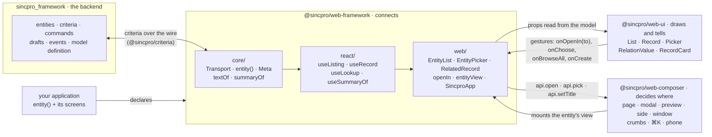
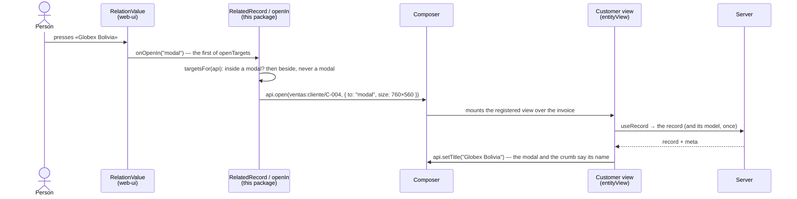
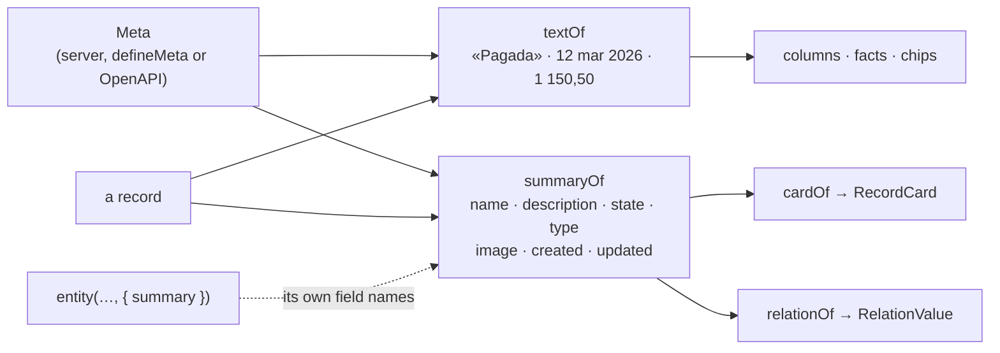

# @sincpro/web-framework

**The web side of how Sincpro builds business software.** It takes what
[`sincpro_framework`](https://github.com/Sincpro-SRL/sincpro_framework) already resolves on the
server — entities, criteria, commands, drafts, events — and puts it on screen with
[`@sincpro/web-ui`](https://github.com/Sincpro-SRL/sincpro_web_ui), opened where
[`@sincpro/web-composer`](https://github.com/Sincpro-SRL/sincpro_web_composer) says. An
application declares its entities and names its fields; the rest follows.

```bash
yarn add @sincpro/web-framework @sincpro/web-ui @sincpro/web-composer @sincpro/criteria @sincpro/criteria-react react react-dom
```

Requires React 19 or newer.

## What we believe

**An ERP is modular, so its framework must be open.** Somebody will always have the case nobody
foresaw — a reconciliation screen, a strange relation, a wizard over three entities. They must
be able to build it here, without asking us and without fighting us. So:

1. **Defaults, never cages.** Every piece comes in three levels, and any of them can be skipped:

   | Level        | What you write                              | Example                                                    |
   | ------------ | ------------------------------------------- | ---------------------------------------------------------- |
   | Declarative  | names of fields and entities                | `<EntityList listing={l} columns={["number", "state"]} />` |
   | Hooks        | your own screen over our state              | `useListing` + web-ui's `List`                             |
   | Loose pieces | straight to criteria, the transport, web-ui | `transport.list(route, criteria)`                          |

   Adding a piece obliges nothing else; removing it breaks nothing else.

2. **We ship good practice, not business rules.** A rule lives in the backend. Here the
   framework reads what the backend publishes — the model definition, the form hints, the
   preview, the refusal — and never re-implements it. If a rule matters, the server keeps it.

3. **Integration should be solved once, here.** Every Sincpro application used to write its
   own client, its own date formatting, its own error box, its own "load more". That is the
   same code everywhere, and it belongs in one place, written well.

4. **The server describes, the screen decides.** The backend says what a field _is_ — its
   word, its type, what it accepts, what it points at. Where it goes, how prominent it is and
   what colour a state is stay in the screen's code. That keeps us out of server-side view
   XML, which is where frameworks like Odoo stop being extensible.

5. **Many entities, one screen.** Business work happens _between_ records: a list with its
   detail beside it, an invoice with its lines, a statement reconciled against invoices. The
   framework is built for that, not for one form at a time.

6. **Use the whole Sincpro stack, not a copy of it.** Composer already knows where things open,
   what is selected and which keys do what; web-ui already knows how a record looks. This
   package uses them — it does not wrap them in a second, weaker version.

## The stack

| Project                 | Brings                                                                                                                                                             |
| ----------------------- | ------------------------------------------------------------------------------------------------------------------------------------------------------------------ |
| `sincpro_framework`     | Entities, criteria, reads (`Get`, `LiteralSearch`, `Search`, `Preview`), commands and dry runs, drafts, events, permissions, protocols (REST, JSON-RPC, gRPC, MCP) |
| `@sincpro/criteria`     | The contract with the server: `Criteria`, `Meta`, `Page`, `Problem`                                                                                                |
| `@sincpro/web-ui`       | What a screen looks like: `List`, `Record`, `SearchBar`, `Picker`, `Activity`                                                                                      |
| `@sincpro/web-composer` | Where it opens and the context: page, peek, window, panels, shared selection, ⌘K, shortcuts                                                                        |
| **this package**        | The glue: entity + model definition + state + actions, drawn with web-ui, opened with composer                                                                     |
| Your application        | What an invoice is                                                                                                                                                 |

## How it fits together

Three packages, one direction. **web-ui draws and tells** («they pressed this name, and asked
for a modal»); it never imports composer and never knows where anything opens. **Composer
decides where** — page, modal, preview, side panel, window, the breadcrumb, the phone — and never
draws a record. **This package connects them**, from what the server publishes about each model.



What happens when a person presses the customer of an invoice:



Everything a screen shows about a value or a record is read from the model the same way, so a
cell, a fact, a card and a link cannot disagree:



## Integrating it in an application

**1. Styles.** web-ui's tokens, and Tailwind told to look inside the packages (Tailwind v4 skips
`node_modules`, so their classes would never be generated). Composer brings its own sheet.

```css
@import "@sincpro/web-ui/tokens.css";
@source "../node_modules/@sincpro/web-ui/dist";
@source "../node_modules/@sincpro/web-framework/dist";
@source "./";
```

**2. The transport** — the one door to the backend. The session is the application's: it puts
its headers here.

```ts
export const transport = restTransport({
  base: "/v1",
  headers: () => ({ Authorization: `Bearer ${session.token}` }),
});
```

**3. The entities** — declared once: where each is read and written, and its key in the
workspace (`domain:kind`). `summary` only when its fields are not the conventional ones.

```ts
export const customers = entity<Customer>("sales:customer", {
  list: "/customers",
  summary: { image: "logo", person: true },
});
export const invoices = entity<Invoice>("sales:invoice", {
  list: "/invoices",
  create: "POST /invoices",
  save: "PUT /invoices/{id}",
  commands: { post: "POST /invoices/{id}/post" },
  history: { route: "/sales-events", type: "Invoice" },
});
```

**4. The views** — each entity becomes a composer view: its list without an id, its record with
one, its search in ⌘K. Declared and nothing more, it already has both screens, drawn from its
model: `EntityList` (literal search on Enter, pages, «New») and `EntityRecord` (its name, type and
state on top; its fields in the model's order, a many2one as a picker of its entity; each
one2many in a tab; «save / discard», the conflict, the restored draft, who made it, its history;
«3 / 64» and the arrows to its neighbours when it was opened from a list).

```ts
const views = [
  entityView(invoices, { transport, name: "Invoices" }), // both screens, from the model
];
```

They are defaults, not cages: give your own screens, or keep `EntityRecord` and choose what it
shows.

```ts
const views = [
  entityView(invoices, {
    transport,
    name: "Invoices",
    list: InvoiceList,
    record: InvoiceView,
  }),
  entityView(customers, {
    transport,
    name: "Customers",
    list: CustomerList,
    record: CustomerView,
  }),
];
```

**5. The application** — transport, language (web-ui's, composer's and the framework's words),
cache, toasts and the workspace, in one place:

```tsx
<SincproApp
  transport={transport}
  views={views}
  entities={[invoices, customers]} // a relation of a model resolves to one of these, alone
  start={invoices.ref()}
  language="es"
/>
```

An application with its own shell mounts the same pieces itself: `FrameworkProvider`, composer's
`Composer` with `webUiSkin`, and the three copy tables.

**6. The screens.** A list is the entity and the names of its fields — the server searches,
filters, orders, groups and pages; a row opens the record's page:

```tsx
function InvoiceList({ api }: ViewProps) {
  const listing = useListing(invoices);
  return (
    <EntityList
      listing={listing}
      api={api}
      columns={["number", "customer", "state", "amount_total"]}
    />
  );
}
```

A record keeps writing web-ui's `Record` tree. Its fields come from the model; a related record
is read with its summary and opened where it belongs; a many2one is chosen with a literal search
on the server, and «Buscar más…» opens the customers' own list to choose from:

```tsx
function InvoiceView({ api, resource }: ViewProps) {
  const invoice = useRecord(invoices, resource.id ?? "");
  const crumbs = useCrumbs(api);
  useRecordInWorkspace(api, invoice); // its real name in the crumb, «unsaved» asks first
  const dirty = dirtyOf(invoice); // «Save / Discard» while something was typed
  if (invoice.status !== "ready") return <Skeleton rows={4} label="Loading" />;
  return (
    <Record
      identity={{ title: invoice.record.number }}
      {...(dirty === undefined ? {} : { dirty })}
    >
      <Record.Rail>
        <Record.Crumbs crumbs={crumbs} />
        {/* Always there on an edited record: without them web-ui remounts the paper on «dirty». */}
        <Record.Actions>
          <CommandButton entity={invoices} id={invoice.id} command="post" label="Post" />
        </Record.Actions>
      </Record.Rail>
      <Record.Paper>
        <Field label="Customer">
          <RelatedRecord api={api} entity={customers} value={invoice.record.customer} />
        </Field>
        <RecordField
          record={invoice}
          name="customer_id"
          as={({ value, set }) => (
            <EntityPicker
              entity={customers}
              value={String(value ?? "")}
              onChange={set}
              onBrowseAll={chooserIn(api, customers, set)}
            />
          )}
        />
        <RecordField record={invoice} name="notes" />
      </Record.Paper>
    </Record>
  );
}
```

Any record, at any size, from its summary:

```tsx
const summarize = useSummaryOf(customers);
<RecordCard
  {...cardOf(summarize(row))}
  onOpen={() => openIn(api, customers.ref(row.id), "page")}
/>;
```

A domain with no sincpro_framework behind it declares its model by hand and is drawn the same
way:

```ts
const tickets = defineMeta({
  aggregate: "Ticket",
  identity: "id",
  display: "title",
  search: ["title"],
  fields: {
    id: field.text({ readonly: true }),
    title: field.text({ label: { es: "Título" }, required: true }),
    stage: field.choice(["new", "done"], { labels: { new: { es: "Nuevo" } } }),
  },
});
```

## The abstractions

Each answers one question, and each comes in the three levels — use the component, drop to the
hook and draw your own, or go straight to the loose piece.

| Question                         | Declarative                                   | Hook                                  | Loose piece                          |
| -------------------------------- | --------------------------------------------- | ------------------------------------- | ------------------------------------ |
| Where is the data?               | `entity()`                                    | —                                     | `restTransport`, `memoryTransport`   |
| What is each field?              | `Meta` from the server, or `defineMeta`       | —                                     | `textOf`, `viewOf`, `metaFromSchema` |
| What is a record, at any size?   | `cardOf`, `relationOf`                        | `useSummaryOf`                        | `summaryOf`                          |
| N records: search, filter, page  | `EntityList`, `EntitySearchBar`               | `useListing`, `useGroups`             | `transport.list(route, criteria)`    |
| A named slice (to collect, …)    | `defineList` + `listView`                     | `useListing(list)`                    | `scopeOf`                            |
| A record's whole screen          | `EntityRecord`, `entityView` without `record` | —                                     | `formOf`                             |
| Previous / next from a record    | `EntityRecord` (from a list)                  | —                                     | `placeOf`, `stepIn` (`Trail`)        |
| How much each group adds up      | `EntityList sums`                             | `useGroups` (`sums`)                  | `sumsOf`, `detailOf`                 |
| One record: read, edit, save     | `RecordField`, `factsOf`, `RecordLines`       | `useRecord`                           | `transport.one`, `transport.send`    |
| Its relations, inside it         | `RelatedList`                                 | `useRelated`                          | `relatedOf`                          |
| Choose one (literal search)      | `EntityPicker`, `chooserIn`                   | `useLookup`                           | `lookupOf` + criteria's `matching`   |
| Choose several (many2many)       | `EntityTags`                                  | `useLookup` (`values`)                | `lookupOf`                           |
| A relation, from the model alone | `RecordField name="customer_id"`              | `useEntityFor`                        | `relationFieldOf`, `entityFor`       |
| Open it where it belongs         | `RelatedRecord`, `entityView`                 | —                                     | `openIn`, `targetsFor`               |
| Act on it (with a dry run)       | `CommandButton`, `commands` on rows           | `useCommand`                          | `transport.send`                     |
| What happened to it              | `Record.Activity` fed by `useHistory`         | `useHistory`                          | `historyOf`                          |
| The application context          | `SincproApp`                                  | `useRecordInWorkspace`, `useFollowed` | `FrameworkProvider`, `webUiSkin`     |

The rules behind them, in short:

- **A reference names any record** (`domain:kind/id`, `entity.ref(id)`). Two contexts talk by
  reference, never by import; whatever must survive a reload travels in it.
- **A related record opens in a modal** the size of a record, and «Abrir en…» offers preview,
  side and page. **From inside a modal**, beside or as a preview — never a modal over a modal.
  `openIn` decides it from what composer says about the view, so no screen writes it.
- **What a record does not have is not drawn**: no picture, no image; no state, no tag.
- **Every word on screen** is the model's (`labelOf`, `choiceLabelOf`) or the framework's copy
  table (`frameworkCopy()`), never a string in a component.

### Inside

Three folders, one direction — `make doctor` keeps the arrows:

| Folder          | Knows                                                                         | Why apart                                             |
| --------------- | ----------------------------------------------------------------------------- | ----------------------------------------------------- |
| `core`          | transport, cache, entity, model definition, what a value and a record read as | plain logic, tested in Node in milliseconds           |
| `react`         | `useListing`, `useRecord`, `useRelated`, `useSummaryOf`…, the provider        | state that draws nothing: usable without `EntityList` |
| `web/list`      | a collection: `EntityList`, `EntitySearchBar`, `columnsOf`                    | N records, any size                                   |
| `web/record`    | one record: `RecordField`, `factsOf`, `RelatedList`, `EntityPicker`, `cardOf` | works outside a workspace (no composer)               |
| `web/workspace` | the composer: `entityView`, `openIn`, `RelatedRecord`, `<SincproApp>`         | where it opens, the application context               |

Everything is imported from `@sincpro/web-framework`.

## Where it stands

| Piece                                  | What it solves                                                                             | Status |
| -------------------------------------- | ------------------------------------------------------------------------------------------ | ------ |
| `restTransport`, `memoryTransport`     | The backend, or the same engine in memory                                                  | ✅     |
| `defineMeta`, `metaFromSchema`         | A model by hand, or completed from OpenAPI                                                 | ✅     |
| `useListing`, `EntityList`             | N records: criteria, search bar, builder, paging                                           | ✅     |
| `useRecord`, `factsOf`, `RecordLines`  | One record: facts, relations with their real total                                         | ✅     |
| Preloaded definitions                  | `FrameworkProvider metas`: the model asked once, or never                                  | ✅     |
| `useLookup`, `EntityPicker`            | Literal search: a many2one select, ⌘K                                                      | ✅     |
| `useRecord` + `RecordField`, `dirtyOf` | Editing: hints evaluated live, preview, save with version (409), server drafts             | ✅     |
| `useCommand`, `CommandButton`          | An entity's actions, with a dry run before what destroys                                   | ✅     |
| `useHistory`                           | Business events in `Record.Activity` (comments: backend first)                             | ✅     |
| `entityView`                           | An entity as a composer view: list, record, ⌘K search                                      | ✅     |
| `<SincproApp>`                         | The application context in one place, the workspace dressed as web-ui (`webUiSkin`)        | ✅     |
| `useRecordInWorkspace`                 | A record tells the workspace its real name and its unsaved work (composer 1.0)             | ✅     |
| Paging by pages, ceiling on «more»     | One page on screen, walked by the server's cursor: a million rows never freeze it          | ✅     |
| `cachedTransport`                      | Repeated reads from memory, forgotten when a write touches the entity (on in `SincproApp`) | ✅     |
| `EntitySearchBar`                      | The search bar + criteria builder as a loose piece, for any `List`                         | ✅     |
| `EntityList` views                     | The same set as table, rows or board                                                       | ✅     |
| `useRelated`, `RelatedList`            | A record's relation as a live list: searched and paged by the server, inside a form        | ✅     |
| `EntityPicker` chooser                 | «see all…» opens the whole set, searched on the server: a many2one over millions           | ✅     |
| `useRecord(entity, "")`, `create`      | A new record: the model's defaults, saved to `create`, then it IS the record it became     | ✅     |
| `retryKeys`, `Idempotency-Key`         | A Command or a create retried after a lost answer runs once, not twice                     | ✅     |
| `entity.newRef()`, «New» in the list   | The record's form with no id, in a page or a window; replaced by the record once created   | ✅     |
| `EntityPicker criteria`                | A many2one narrowed by another field: the invoices OF the chosen customer                  | ✅     |
| `chooserIn`, `entity.chooserRef()`     | «see all…» as the composer's chooser: a row answers (`api.pick`)                           | ✅     |
| `useGroups`, «Group by»                | Groups counted by the server over the whole set; a group's rows read when it is opened     | ✅     |
| `defineList`, `listView`               | A named list (a fixed scope, its columns and filters) as data, and as a workspace view     | ✅     |
| `EntityPicker` `browse`, `columns`     | The chooser always a click away, as a table searched literally by the server               | ✅     |
| `useFollowed`                          | A detail panel follows the record the person is on, without knowing the list               | ✅     |
| `commands`, `useRowCommands`           | An entity's Commands on each row, idempotent, offered only where `when` holds              | ✅     |
| `summaryOf`, `cardOf`, `relationOf`    | Any record at any size: name, description, state, type, picture, who made and changed it   | ✅     |
| `openIn`, `RelatedRecord`              | A related record opens in a modal; «Abrir en…» for the rest; never a modal over a modal    | ✅     |
| Literal search everywhere              | Picker: the first ten, the server's search as you type; tables: «Buscar «X»» on Enter      | ✅     |
| `EntityTags`                           | A many2many as chips over thousands: the server's search, faces, the chosen never again    | ✅     |
| `RecordField` + `entities`             | A many2one / one2many drawn from the model alone, opened where the view says               | ✅     |
| `EntityRecord`, `formOf`               | Any entity's record screen without writing it                                              | ✅     |
| `Trail`, `Record.Pager`                | Previous / next from a record, across the server's pages                                   | ✅     |
| `EntityList sums`                      | Each group says how much it adds up, summed by the server over all of it                   | ✅     |

What it does **not** do: mobile (`sincpro_mobile` has its own core), sessions and login (the
application's), routing (composer's), string-named widget registries, technical logs on a
record's screen, business rules.

The full purpose — literal search, drafts, composer context, several entities per screen — is
in [`docs/PURPOSE.md`](docs/PURPOSE.md); what was found while building and what comes next is in
[`docs/ROADMAP.md`](docs/ROADMAP.md) (both in Spanish).

## Built for large sets

Nothing is filtered, ordered, counted or grouped on the page: every gesture is a question the
server answers. A list holds ONE page by default and walks the server's keyset cursor (page
4 000 costs what page 1 costs); «load more» stops at a ceiling and asks to narrow the search; the
count is the server's, capped; typing waits for a pause; a newer question cancels the older one;
the model definition is asked once per entity; repeated reads come from a cache that a write
clears. Story «15 · Un conjunto grande sin congelar» runs it over 200 000 rows.

## The use cases are the tests

Every use case is a Storybook story run against an in-memory server that answers with the same
criteria engine as sincpro_framework, and each one carries a `play`. The story IS the test:
`make test` runs every story in a real Chrome with vitest (`@storybook/addon-vitest`), awaits its
play and checks its a11y — and the same tests run from Storybook's sidebar («Run tests»). The
plain logic is tested in Node by the same runner. A case the framework cannot do yet shows up
there first.

## Development

```bash
nvm use       # Node 26, from .nvmrc
make init     # pre-commit + yarn install
make test     # vitest: the logic in Node + every use case (story + play) in Chrome
make dev      # Storybook on :6008 — the use cases, «Run tests» in the sidebar
make build
```

Every operation — local or CI — goes through the `Makefile`; run `make` to list the targets.
Working on this repository, human or agent: read [`AGENTS.md`](AGENTS.md) first.

## CI/CD

The workflows in `.github/workflows/` only delegate to the shared `Sincpro-SRL/.github`
pipeline, which calls `make init`, `make verify-format`, `make test`,
`make update-version VERSION=x` and `make publish`.

## License

MIT © Sincpro S.R.L.
