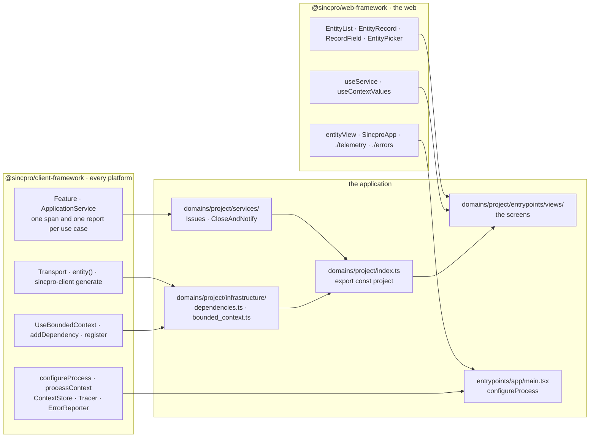

# How a Sincpro web application is built

How **any** Sincpro web application is built — the ERP's backoffice, a POS, a customer portal,
an ecommerce — with one architecture (DDD + clean), the same vocabulary as sincpro_framework in
Python and as `@sincpro/mobile`, and with telemetry, errors and cache by default. This package
gives the base; the application adds, modifies or extends on top of the code, in marked places.

- **Status**: §6 (the services) and §7 (the context) are implemented — @sincpro/client-framework
  0.3 and `useService` / `useContextValues` here; the rest is the proposal of 2026-11-05. The plan is in
  [`prd/PRD_02_how-an-application-is-built.md`](prd/PRD_02_how-an-application-is-built.md) and the research that backs it,
  with its sources, in [`prd/PRD_02_research.md`](prd/PRD_02_research.md).
- The concrete API of each piece — bounded context, application, context levels, events, errors,
  components — is in [`prd/PRD_03_design.md`](prd/PRD_03_design.md).
- What the package IS and why it exists is still in [`PURPOSE.md`](PURPOSE.md); how what is
  generated from the contract is adopted, in [`ADOPTION.md`](ADOPTION.md).

## 0. Ubiquitous language

The words are the same in sincpro_framework, @sincpro/client-framework, this package and
@sincpro/mobile. The canonical table — what each word is, what it is called in each framework,
which words are not used and where they still differ — is client-framework's
[`UBIQUITOUS_LANGUAGE.md`](https://github.com/Sincpro-SRL/sincpro_client_framework/blob/main/docs/UBIQUITOUS_LANGUAGE.md).
Prose, in any doc, uses those words as they are: **the bounded context**, **a Feature**, **an
ApplicationService**, **the process**, **the context** (only the values a use case runs with,
never a bounded context's name), **the execution**. Nobody says «framework», «runtime», «bus» or
«domain» for a bounded context: `domain/` is a layer inside it. Spanish appears only in
Storybook prose and the Spanish copy table.

What each package gives and what the application writes:



## 1. One architecture

The backend has already laid it out (forge: `sincpro_forge/entrypoints/` +
`domains/{common,auth,…}`). The web copies that shape layer by layer; the only new thing is
`components/`, because the backend does not draw.

| sincpro_framework (forge)                                                         | Web                                                             | What it is                                     |
| --------------------------------------------------------------------------------- | --------------------------------------------------------------- | ---------------------------------------------- |
| `entrypoints/http.py` (composes the gateways)                                     | `entrypoints/<app>/` (composes the bounded contexts in a shell) | Where the outside comes in. Composes, no logic |
| `entrypoints/subscriber.py`                                                       | `domains/<ctx>/entrypoints/live.ts`                             | What comes from outside, with no screen        |
| `domains/common/` (`infrastructure/`, `settings.py`)                              | `domains/common/`                                               | What is shared                                 |
| `domains/<ctx>/domain/`                                                           | `domains/<ctx>/generated/domain.ts` + `domain/`                 | The language                                   |
| `domains/<ctx>/adapters/`                                                         | `domains/<ctx>/generated/client.ts` + `adapters/`               | The external things                            |
| `domains/<ctx>/services/` — one file per use case                                 | `domains/<ctx>/services/`                                       | `Feature` and `ApplicationService`             |
| `domains/<ctx>/infrastructure/` (`framework.py`, `context.py`, `dependencies.py`) | `domains/<ctx>/infrastructure/`                                 | The bounded context's wiring                   |
| `domains/<ctx>/entrypoints/`                                                      | `domains/<ctx>/entrypoints/`                                    | Its views, its events, its widgets             |
| —                                                                                 | `domains/<ctx>/components/`                                     | The pieces of each entity                      |

In mobile the same shape exists (`DomainModule`, `Feature`, `ApplicationService` with
interceptors); what mobile has because it is offline — SQLite, a persistent queue, migrations,
sync crons — does not come to the web: here the truth is on the server.

## 2. The tree

An application:

```text
src/
├── entrypoints/               where the outside comes in: the shell, the session, the App level. No logic
│   └── app.tsx
└── domains/
    ├── common/                what bounded contexts share (§4)
    │   ├── domain/            the shared language: Money, Address, the reference to a person
    │   ├── components/        how that language is drawn: MoneyField, AddressBlock, PersonAvatar
    │   ├── infrastructure/    the cross-cutting and the non-functional (§5)
    │   └── settings.ts
    └── project/               a bounded context
        ├── generated/         from the contract: domain.ts, client.ts, entities.ts, contract.json — NEVER edited
        ├── domain/            its own types and pure rules, over what is generated
        ├── adapters/          other external things: a map, a printer, a third-party service
        ├── services/          one Feature (a facade) or one ApplicationService per file, and index.ts (§6)
        ├── infrastructure/    dependencies.ts, bounded_context.ts (§5)
        ├── components/        what the bounded context shares, loose; each entity's pieces in its folder
        │   └── issue/         its kit: row, card, option, field controls, sections (§9)
        ├── entrypoints/       views/ (the screens), live.ts (real time), widgets.ts
        └── index.ts           the bounded context, ready (`export const project = …`): the only thing imported from outside
```

A product with several applications (backoffice, POS, portal, shop) is a monorepo (pnpm
workspaces): each application is an entrypoint and each bounded context a package the
applications share.

```text
sincpro_<product>_web/
├── entrypoints/
│   ├── backoffice/            SPA + composer (SincproApp)
│   ├── pos/                   SPA + offline PWA
│   ├── portal/                SPA, or SSR if needed
│   └── shop/                  SSR (SEO)
└── domains/
    ├── common/
    ├── ventas/                package: exports ".", "./react", "./web", "./workspace"
    └── inventario/
```

Only the folders that hold something exist: an entity with no pieces of its own has no folder
and is drawn from its meta (grow with evidence, as Sincpro's architecture guide says).

## 3. The layers and what each one imports

| Layer                      | May import                                                    | Never                                                      |
| -------------------------- | ------------------------------------------------------------- | ---------------------------------------------------------- |
| `generated/`, `domain/`    | criteria, the framework's `core`, `common/domain`             | React, DOM, an adapter                                     |
| `adapters/`                | `domain/`, the framework's `core`                             | React                                                      |
| `services/`                | `domain/`, `adapters/` (through dependencies), `common`       | React, web-ui, composer, `window`, another bounded context |
| `infrastructure/`          | everything above, `common/infrastructure`                     | components                                                 |
| `components/`              | `services/` (through hooks), `domain/`, web-ui, the framework | composer, a router, another bounded context                |
| `entrypoints/`             | everything in the bounded context, composer                   | another bounded context                                    |
| `common/`                  | only itself and the framework                                 | any bounded context                                        |
| `entrypoints/<app>` (root) | each bounded context's `index.ts`                             | a bounded context's internal `src/`, business rules        |

- **A bounded context never imports another.** They talk by reference (`domain:type/id`): a
  relation `relation: "auth.Tenant"` is drawn with the kit `auth` publishes, resolved by the
  shell's registry of bounded contexts (`entityFor`, story 41). What two bounded contexts truly
  share goes to `common`.
- **Another entity of the same bounded context** is imported only through its `index.ts`.
- **Enforced, not recommended**: `sincpro-client check --root src` (client-framework) resolves every
  import with the application's own TypeScript and `tsconfig` — its aliases included — and fails
  on each break of the table above; each application's `make doctor` runs it, as the framework's
  own doctor runs its rules.

## 4. `common`, what bounded contexts share

The language that two or more bounded contexts speak, and the cross-cutting.

- **In**: a type or value that 2+ bounded contexts use (`domain/`), the component that draws it
  (`components/`), the cross-cutting infrastructure (`infrastructure/`), the configuration
  (`settings.ts`).
- **Out**: services and entrypoints — `common` does not orchestrate and nothing comes in through
  it, as in forge (`domains/common/` has `infrastructure/` and `settings.py`); nothing of a
  single bounded context «just in case»; what one bounded context offers another (the tenant
  picker is `auth`'s).
- Everyone imports from `common`; `common` imports no bounded context.

> Sincpro's guide (`sincpro_architecture_guidelines` §3.1 and §6) says `shared/` and forbids
> `common/`, but forge's backend uses `common/`. `common` was chosen; the guide is corrected so
> that the web, the backend and the guide say the same.

## 5. `infrastructure`, in two places

The rule to decide: if swapping it for an equivalent one changes the business's behaviour, it is
an adapter; if it is wiring, a client with no business in it, or something non-functional, it is
infrastructure.

| Where                    | What                                                                                                                                                                                                                                                                                                                                                          | In forge                                                    |
| ------------------------ | ------------------------------------------------------------------------------------------------------------------------------------------------------------------------------------------------------------------------------------------------------------------------------------------------------------------------------------------------------------- | ----------------------------------------------------------- |
| `common/infrastructure/` | The **raw client** (the transport with its base, headers and auth), the session and who is calling (`/me`), where the context lives (the platform's `ContextStore`), telemetry and error reporting (their adapters and configuration), the `QueryClient`                                                                                                      | `access.py`, `context_store.py`, `database.py`, `events.py` |
| `<ctx>/infrastructure/`  | `dependencies.ts`: the type of what each service may use (`ProjectDependencies`: the generated client, the session, another bounded context's service through its `index.ts`) and `registerDependencies` with `addDependency`. `bounded_context.ts`: its `Feature` and its `ApplicationService` typed with that type, and `configProjectBoundedContext(name)` | `dependencies.py`, `framework.py`                           |

## 6. The services: `Feature` and `ApplicationService`

**All of the application's logic lives in services**, of two kinds — those of sincpro_framework
and of mobile — and each bounded context is assembled as in the backend:

- **`Feature`**: a facade over one part of the domain. Each public method is a use case.
- **`ApplicationService`**: composes Features of **its own** bounded context
  (`this.feature.Issues.close(…)`). Never another ApplicationService.

Their dependencies are typed properties (`this.client`, `this.session`): the bounded context
hands them in on each call, typed with its `DependencyContextType`.

```ts
// domains/project/infrastructure/dependencies.ts — what each service may use
export interface ProjectDependencies {
  client: ProjectClient;
  session: Session;
}
export function registerDependencies(bc: UseBoundedContext<ProjectDependencies>) {
  bc.addDependency("client", clientOf(transport));
  bc.addDependency("session", session);
  return bc;
}

// domains/project/infrastructure/bounded_context.ts
export class Feature extends BaseFeature<ProjectDependencies> {}
export class ApplicationService extends BaseApplicationService<
  ProjectDependencies,
  ProjectFeatures
> {}
export function configProjectBoundedContext(name: string) {
  return registerDependencies(new UseBoundedContext<ProjectDependencies>(name));
}

// domains/project/services/issues.ts
export class Issues extends Feature {
  close(input: dto.CommandCloseIssue) {
    this.session.require(); // the client's validation lives in the service
    return this.client.closeIssue(input);
  }
}

// domains/project/services/close_and_notify.ts
export class CloseAndNotify extends ApplicationService {
  async execute(input: dto.CommandCloseIssue) {
    await this.feature.Issues.close(input); // child span
    return this.feature.Notices.tell(input); // child span
  }
}

// domains/project/services/index.ts
export const features = { Issues, Notices };
export const applicationServices = { CloseAndNotify };
export type ProjectFeatures = typeof features;

// domains/project/index.ts
export const project = configProjectBoundedContext("project").register({
  features,
  applicationServices,
});
```

From anywhere — a screen, another bounded context, a test — it is used by name:
`await project.Issues.close(input)`; in a screen, `useService(project.Issues.close)`. `project`
only holds references (each service is created once, the first time it is asked for) and is not
frozen: `project.with({ client })` and `project.scoped({ company_id })` give a variant that shares
everything else.

**No bus, with interceptors** — like `@sincpro/mobile`: every public method of a service goes
through the bounded context's interceptors, and that gives **by default**, without the author
writing anything:

1. **the trace**: one span per use case, `<bounded context>/<Service>.<method>`
   (`project/Issues.close`), with `sincpro.*` attributes like the backend's; the transport writes
   `traceparent` and the backend continues the SAME trace (§8);
2. **the error**: the unexpected is reported with its `trace_id`; what the server already
   explained (a validation, a conflict) is not (§8);
3. **the context**: a snapshot of its levels per call (§7).

One difference from mobile, on purpose: mobile keeps the active span in a **global stack** (push
in `before`, pop when the promise ends). With two async calls at once they cross — the second
takes the first as its parent and the first, when it ends, pops the second's entry. In a web
workspace several views ask at once, so here **each call carries its own execution**: an
ApplicationService's call gives its Features its span as their parent. The API for the author is
the same; the fix goes back to mobile.

The rules are those of `sincpro_framework_use_cases`, without exception:

- Reusing a use case is **calling it through its bounded context** (`this.feature.Issues`,
  `project.Issues`); never a function exported from another service («helper», `existing_*`,
  `*_command(…)`), because it skips the trace and the error.
- `domain/` receives no adapters: a lookup that two Features share is an adapter in the
  dependencies.
- A service does not import React: it is tested in Node with `memoryTransport`, without drawing
  anything.
- What the backend publishes (meta, preview, `Problem`) a service reads and uses; the business
  rule that the backend validates is not copied.

**The framework ships its own Features** for what every entity does — list, read a record, edit
with preview and draft, save with a conflict, run a command with a dry-run, literal search, the
history, group, pivot — which today live inside the hooks. Once they are Features, a generated
screen has traces and errors without writing anything, and an application's ApplicationService
can compose them with its own.

## 7. The context levels and where state lives

| Level               | How long it lives                | What it carries                                                                                                                                               | Who opens it                                              |
| ------------------- | -------------------------------- | ------------------------------------------------------------------------------------------------------------------------------------------------------------- | --------------------------------------------------------- |
| **Process**         | The session                      | Who is calling, tenant/company, language, time zone, transport, `QueryClient`, telemetry, the registry of bounded contexts                                    | `entrypoints/<app>`: `configureProcess`, `processContext` |
| **Bounded context** | While it is loaded               | Its client over ITS backend (each bounded context brings its base in `bindings`), its entities and metas, its services, its context level (`project.context`) | `<ctx>/index.ts`                                          |
| **Window**          | As long as an opening lasts      | What was opened (`ResourceRef` with `params`), over what (`over`), whether it is choosing (`choosing`), where (`surface`)                                     | composer; the framework exposes it to the components      |
| **Record**          | As long as a record is on screen | The editing, the draft, the lines, the preview, the errors                                                                                                    | the framework (a store per instance)                      |
| **Execution**       | One call to a service            | A snapshot of the levels above plus the parent span                                                                                                           | the interceptors                                          |

- Each level reads the one above, never the one below or beside it.
- A service never reads React: it receives the execution's snapshot (`this.context`): the
  process's values, over them its bounded context's, over those a scope's
  (`project.scoped({...})`), read once where the gesture starts.
- What the backend has to see travels in headers: `sincpro-context` and `traceparent`.
- **What a screen reads and writes is a use case too**: `FrameworkProvider` sends every request
  the screens make through `screensTransport` (client-framework) — traced, with the process's
  context, reported when it failed — and a change of the context reads every screen again and
  forgets the cache.
- **Where the context lives is the platform's** (`ContextStore`, like sincpro_framework's):
  memory by default, `sessionStorage` or the screens' store in the browser, MMKV on the phone.
  The API is the same on the web and on mobile: `processContext.set({ tenant_id })`,
  `project.context.get("warehouse_id")`, and a screen reads it with
  `useContextValues(processContext)`.

**Where each kind of state lives** (detail and sources in the research):

| State                                                                                                      | With what                                                           | Why                                                                                                                                                                                        |
| ---------------------------------------------------------------------------------------------------------- | ------------------------------------------------------------------- | ------------------------------------------------------------------------------------------------------------------------------------------------------------------------------------------ |
| What the server says (lists, records, metas)                                                               | **TanStack Query**, under the hooks — it replaces `cachedTransport` | Invalidates by key and **tells everything mounted**: saving in a modal refreshes the page's list; two windows that read the same thing make one request; persists in IndexedDB for the POS |
| Dependencies and levels (transport, client, window)                                                        | **React Context**, only to inject                                   | Context redraws all its consumers on every change: it is injection, not a store                                                                                                            |
| What changes with every keystroke, bounded to one instance (a record being edited, the POS cart, a wizard) | **A store per instance** (vanilla Zustand: `createStore` + Context) | Selectors without redrawing the whole form; it is born from the props and tested in isolation                                                                                              |
| What the person chose (columns, filters, saved views)                                                      | Data — on the server, never in `localStorage` as the truth          | It travels with the person; the framework validates it                                                                                                                                     |

Cache keys come from a single factory per entity (`[bounded context, entity, "list", criteria]`,
`[bounded context, entity, "record", id]`, `["meta", bounded context, model]`) and what is public
is `invalidate(entity, ids?)`, never the raw keys. Which other entities a command touches is for
the backend to publish; until it does, the entity and what the route names are invalidated, as
today.

## 8. Telemetry and errors, by default

As in sincpro_framework: the author of a Feature opens no spans and catches no errors; the
framework does.

- **Traces**: a `Tracer` seam in the `core` (with no OpenTelemetry dependency) and an
  OpenTelemetry adapter (`@opentelemetry/sdk-trace` 3.x, OTLP/HTTP, W3C propagator) in a separate
  entry that loads without blocking the first draw: whoever does not use it pays 0 bytes. **One
  span per use case**, not per click or per fetch: no auto-instrumentation and no Zone.js. The
  transport writes `traceparent`/`tracestate` only toward its own origins (never to a payment
  gateway). It exports to the same Collector as the backend and mobile; sampling and redaction
  happen in the Collector.
- **Errors**: an `onError(error, { traceId, problem })` hook that the interceptors fire, an error
  boundary per window and the root's (`createRoot(…, { onUncaughtError })`). The adapter to the
  Sentry SDK pointed at **GlitchTip** — the same place as the backend — goes in another entry,
  with data collection restricted by default (in an ERP the bodies are invoices and customers)
  and without Sentry's tracing (no two traces per request). The unexpected is reported; a
  `Problem` that the server explained is not.
- **Support code**: the `trace_id` of the `Problem` is shown in `Refused` («support code»), with
  its text in the copy table.
- **The application's**: the DSN, the Collector's endpoint, the rates, the release, the upload of
  source maps and the CORS that accepts `traceparent`, `tracestate` and `sincpro-context`.

## 9. Components per entity, and extension

An entity moves up a level only when it needs to:

| Level             | What there is                                                                                                                                                      | Where                            |
| ----------------- | ------------------------------------------------------------------------------------------------------------------------------------------------------------------ | -------------------------------- |
| **N0**            | It is in the contract: regenerate and it already has a list, a record, a picker, ⌘K and commands, drawn from its meta                                              | Nothing, not even a folder       |
| **N1 — present**  | How it looks: its row, card, option; the control of a field, typed by entity and field                                                                             | `components/<entity>/` (its kit) |
| **N2 — insert**   | A section, column, action or tile in a **slot**, `{ after \| before: anchor }`. The backend publishes the anchor (a field, a section of the form hints, a command) | the kit                          |
| **N3 — new view** | A view built with the framework's blocks (`useRecordScreen`, `RecordField`, the lines editor, `useRecord`), which keep the draft, the preview and the commands     | `entrypoints/views/`             |
| **N4 — replace**  | A screen written whole over services and hooks                                                                                                                     | `entrypoints/views/`             |

To draw a piece of an entity, the search goes, in order: the entity, its bounded context's
`components/`, `common/components`, the framework's default by the meta.

**Precedence**, lowest to highest: the framework's default < the owning bounded context < the
application < the tenant's design (data) < the person's choice (data). The code layers are
resolved at start-up; the data layers only choose, order and configure what already exists,
validated against its schema.

**What keeps order** (what SAP Fiori, Power Apps PCF, Salesforce and Backstage do, and what Odoo
does not):

- each extension has a unique id; two with the same id in the same layer are an error at
  start-up;
- an override creates something new; nothing mutates globally — **never `patch()`**: if a slot is
  missing, it is added to the framework and noted in the ROADMAP;
- an anchor that does not exist is an error in development and in the tests, not a «goes at the
  end»;
- only lists (sections, columns, actions, tiles) are merged, by anchor; in everything else the
  upper layer wins;
- components are assigned by typed reference, **never a widget named by a string**;
- visibility and rules are sent by the backend; variants go by surface (page, peek, modal, POS,
  portal) and by application, never by role — permissions are business.

**Widgets** (tiles on the home page and the POS, portal blocks, the side of a record): the owning
bounded context declares them — a stable id (`ventas:widget/por-cobrar`), the host where it may go
(`Home`, `PosGrid`, `PortalPage`, `RecordAside`, each with its type), its configuration schema and
its data, always from the server (counts and sums the server aggregates). The application builds
each host's catalog with imports; the tenant's design is data,
`{ host, items: [{ id, config, order }] }`, validated against that catalog. The only string is the
persisted id, resolved against a closed, typed catalog.

## 10. Real time and media

- **Real time is an entrypoint**, nothing more (`entrypoints/live.ts`): a source (`LiveSource`,
  SSE first, resuming by `Last-Event-ID`) brings `{ entity, type, ids, model_version }` and what it
  does is invalidate — the data is read again by its normal path. A record with unsaved changes is
  not overwritten: it is marked «changed on the server». Between tabs, a `BroadcastChannel` of our
  own carries the same event, never data. The source on the server side is sincpro_framework#201
  (events over SSE).
- **Media**: uploading with progress is an adapter (XHR, with a function that signs the URL;
  multipart for large files); recording audio or video (`getUserMedia` + `MediaRecorder`) is a
  browser adapter; the player and the recorder are web-ui's; a call (WebRTC: SFU, TURN,
  signalling) is the application's, with its signalling as a live source.

## 11. The shells: one architecture, several applications

Bounded contexts do not know which application they run in: no router, no `window` at module
level; configuration and the session come in through the context levels or the transport's
headers, and their services are pure async functions (an SSR loader calls the same Feature).

| Application      | Shell                                                                      | Its own                                                                                                                                                                                                                                |
| ---------------- | -------------------------------------------------------------------------- | -------------------------------------------------------------------------------------------------------------------------------------------------------------------------------------------------------------------------------------- |
| Backoffice / ERP | SPA (Vite) + composer (`SincproApp`)                                       | Many windows at once, ⌘K, the default UI from the meta                                                                                                                                                                                 |
| POS              | SPA + PWA                                                                  | Offline: the cache persisted in IndexedDB, sales queued in order per till, the idempotency key is the client's UUID v7 (`newEntityId`); the queue empties on `online`/`visibilitychange` (Background Sync is not in Safari or Firefox) |
| Customer portal  | SPA; SSR only if needed                                                    | Pages, not windows                                                                                                                                                                                                                     |
| Ecommerce        | SSR (React Router in framework mode, to be weighed against TanStack Start) | SEO; never third-party trackers                                                                                                                                                                                                        |

There are no micro-frontends between our own bounded contexts: a monorepo and lazy loading per
view. Module Federation only if third-party extensions are someday installed at run time.

## 12. What the framework gives and what the application writes

| The framework                                                                                                             | The application                                     |
| ------------------------------------------------------------------------------------------------------------------------- | --------------------------------------------------- |
| `Transport` and its implementations; `entity()`; meta and discovery                                                       | Its `common/infrastructure`: base, headers, session |
| `Feature` and `ApplicationService` with interceptors; its entity Features                                                 | Its Features and ApplicationServices                |
| The context levels; TanStack Query under the hooks; the store per instance                                                | Which bounded contexts each application loads       |
| Telemetry and errors: the seam, the adapters, the support code                                                            | DSN, Collector, sampling, source maps               |
| The default UI from the meta (N0) and the slots (N1–N2)                                                                   | Its kits, views and widgets                         |
| The backoffice shell (`SincproApp`)                                                                                       | The POS, portal and shop shells, their login        |
| The generator (`sincpro-client generate`, from @sincpro/client-framework) and the scaffolding (`new domain/feature/view`) | `make client`, `make verify-client`                 |
| The import rule preset for `make doctor`                                                                                  | Running it in its CI                                |

## 13. What already exists and where it lands

| Today (1.1.0)                                                                                | In this architecture                                                                                    |
| -------------------------------------------------------------------------------------------- | ------------------------------------------------------------------------------------------------------- |
| `Transport`, `restTransport`, `memoryTransport`                                              | Adapters — they stay                                                                                    |
| `cachedTransport`                                                                            | Replaced by TanStack Query (`invalidate`)                                                               |
| `entity()` with typed commands and answers, `bodyFor`, `listRoute`                           | They stay; the generated entity is each bounded context's adapter                                       |
| Meta, discovery by ETag, `relationFieldOf`, `entityFor`, texts                               | They stay; the meta becomes a query with an infinite `staleTime`                                        |
| `useListing`, `useRecord`, `useCommand`, `useLookup`, `useHistory`, `useGroups`, `usePivot`… | Their logic moves to the framework's Features; the hooks stay as the UI's entrypoint, with the same API |
| `EntityList`, `EntityRecord`, `RecordField`, pickers, lines, `CommandButton`, `presented`    | Components: N0 and N1; `presented` grows into the kit                                                   |
| `SincproApp`, `entityView`, `listView`, skin                                                 | The backoffice shell; it receives bounded contexts                                                      |
| `FrameworkProvider`                                                                          | App level                                                                                               |
| `ListScopeProvider`, `RecordOpeningProvider`                                                 | Window level                                                                                            |
| `sincpro-client generate`                                                                    | `generated/` per bounded context, plus the scaffolding                                                  |
| Drafts, preview, conflict, `newEntityId` (UUID v7), copy table                               | They stay                                                                                               |
| Time zone: `installTimeZone`, `wallTimeOf`, `instantOf`, `dayOf`                             | @sincpro/client-framework's (every platform needs them); `FrameworkProvider timeZone` installs it there |
| `make doctor`                                                                                | Plus the preset for applications                                                                        |

**The framework inside** keeps its published entries (`.`, `./core`, `./codegen`) and adds: the
services and the interceptors (no React), and two entries that nothing else imports — telemetry
and error reporting — as the generator is today.

## 14. What is not done

- A UI event bus in the style of mobile: refreshing across windows is the cache's invalidation,
  and real time is an entrypoint.
- A CRUD `dataProvider` with a «custom» for everything else (refine, react-admin): a bounded
  context's commands are first-class, typed from the contract.
- Generating code by guessing from sample data: it is generated from the contract.
- Access control on the client, auditing on the client.
- `patch()`, XPath over structure, registries by string, `force`.
- A global Context with 34 members (the lesson from distribution): each thing at its level.
- Context as a store for state that changes often.
- A router, `window` or storage inside a bounded context.
